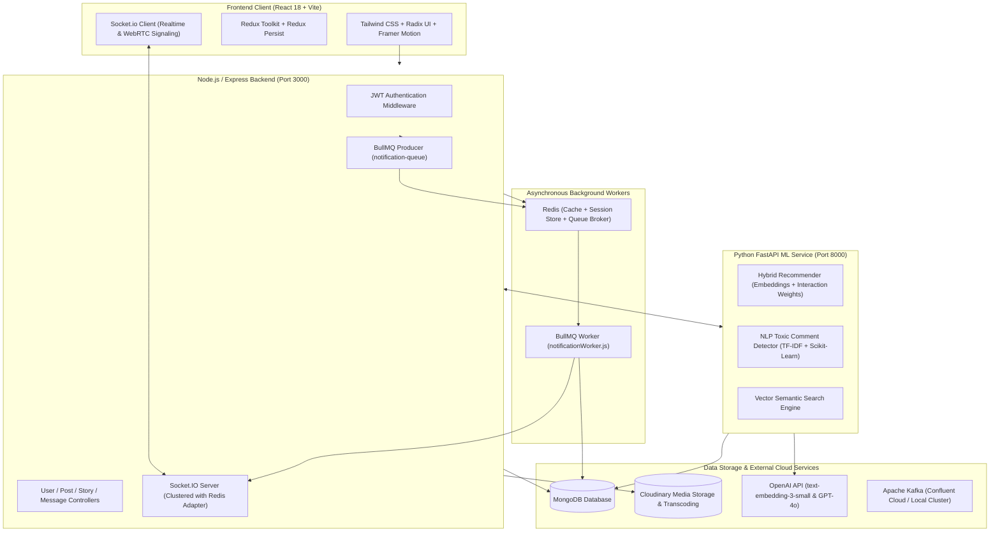

# 📸 NexaSocial — Next-Generation Social Media Platform

A full-stack, distributed Instagram-scale social network built with **React 18**, **Node.js/Express**, **FastAPI ML Service**, **MongoDB**, **Redis**, **BullMQ**, and **Socket.IO**. NexaSocial combines classic social media features (Posts, Reels, 24h Stories, Highlights, P2P Calling) with modern AI/ML capabilities (Hybrid Recommendation Engine, Custom NLP Toxic Comment Moderation, OpenAI-Powered Caption & Tag Generation, Semantic Search, and Multi-language Translation).

---

## 🌟 Key Highlights

- **⚡ Modern Responsive UI**: Pixel-perfect Instagram clone built using React 18, Vite, Tailwind CSS, Radix UI primitives, Lucide Icons, and Framer Motion.
- **🧠 Python ML Microservice**: Dedicated FastAPI microservice providing a hybrid recommendation algorithm (content-based embeddings + implicit interaction weights + time decay), custom Scikit-Learn toxic content classifier, and semantic vector search.
- **💬 Real-Time Communications**: Socket.IO-powered real-time direct & group messaging, voice notes recording, file transfers, message pinning, emoji reactions, and live typing indicators.
- **📞 Audio & Video Calls**: Real-time peer-to-peer WebRTC / Socket signaling for high-quality audio and video calling with incoming call popups and history tracking.
- **🚀 Event-Driven Background Processing**: BullMQ and Redis task queues for decoupled, asynchronous notifications and high-throughput event processing.
- **🤖 Gen-AI Suite**: OpenAI GPT-4o / Vision integrations for automatic post caption generation, intelligent hashtagging, AI smart chat replies, and instant comment translation.
- **🛡️ Enterprise Privacy & Security**: JWT-based authentication in HTTP-only cookies, account privacy controls (Public / Private profiles), and mutual follow-request workflows.

---

## 🏗️ Architecture Overview



---

## 🚀 Features Matrix

### 1. Social Feeds & Media Sharing
- **Dynamic Home Feed**: Cached via Redis for sub-millisecond retrieval with automatic cache invalidation upon post creation.
- **Instagram Reels**: Full vertical short-form video player with audio track preview, pause/play toggles, and synchronized engagement metrics.
- **Audio Integration**: Attach songs/tracks with custom start timestamps to image and video posts.
- **Stories & Highlights**: 24-hour self-expiring stories, view-count tracking, viewer list inspection, story likes, and persistent profile highlights.
- **Post Interactivity**: Double-tap like animations with confetti, bookmarking/saving, and rich comment threads.

### 2. Deep Interactivity & Comments
- **Threaded / Nested Replies**: Multi-level hierarchical comment discussions.
- **AI Smart Replies**: Context-aware comment replies generated on the fly via OpenAI.
- **Comment Translation**: One-click in-place translation of foreign comments into the user's preferred language.
- **ML Moderation Guard**: Automated filtering and flagging of abusive or toxic comments before publication using custom TF-IDF Scikit-Learn models.

### 3. Direct Messaging & Peer-to-Peer Calls
- **Real-Time Chat**: Direct 1-on-1 and Group chats with online/offline presence indicators.
- **Voice Messages**: Record, preview audio waveforms, and stream voice notes directly in conversation bubbles.
- **Media & File Attachments**: Upload documents, media, and images directly into chat.
- **Message Pinning & Reactions**: Pin crucial messages to the chat header and react with emojis.
- **Audio & Video Calling**: Full WebRTC audio/video call integration with ringtone audio notifications, mute/unmute, and camera toggling.

### 4. Advanced Machine Learning Suite
- **Hybrid Recommendation Engine**:
  - Implicit feedback weighting (Bookmarks: $\times 3$, Likes: $\times 1.5$)
  - OpenAI `text-embedding-3-small` vector similarity
  - Exponential time decay algorithm prioritizing fresh, relevant content
- **Semantic User & Post Search**: Find users and posts based on natural language concepts and bios rather than rigid keyword matching.
- **Smart Follow Suggestions**: ML vector clustering to recommend creators with aligned interests.

---

## 🛠️ Tech Stack

| Domain | Technology / Library |
| :--- | :--- |
| **Frontend Framework** | React 18, Vite, React Router DOM v6 |
| **Styling & Components** | Tailwind CSS, Radix UI, Lucide React, Framer Motion, Canvas Confetti |
| **State Management** | Redux Toolkit, Redux Persist |
| **Primary Backend** | Node.js, Express.js (ES Modules) |
| **ML Microservice** | Python 3.10+, FastAPI, Uvicorn, Scikit-Learn, NumPy, SciPy |
| **Databases** | MongoDB (via Mongoose & PyMongo) |
| **Caching & Queues** | Redis (ioredis & redis-adapter), BullMQ |
| **Realtime Communication** | Socket.IO, WebRTC Signaling |
| **AI / NLP APIs** | OpenAI (GPT-4o, text-embedding-3-small), Clipdrop API |
| **Media Processing** | Cloudinary API, Sharp (Image optimization & WebP conversion) |
| **Message Streaming** | Apache Kafka (Confluent Cloud / Dockerized Confluent-Local) |

---

## 📁 Repository Structure

```plaintext
instagram/
├── docker-compose.yml              # Local Confluent Kafka & Redis infrastructure
└── Insta/
    ├── backend/                    # Node.js + Express API server
    │   ├── config/                 # Redis, Kafka, and BullMQ configurations
    │   ├── controllers/            # User, Post, Story, Highlight, Message controllers
    │   ├── middlewares/            # Multer file upload & JWT auth verification
    │   ├── models/                 # Mongoose schema models
    │   ├── queues/                 # BullMQ producers
    │   ├── routes/                 # Express REST endpoint routes
    │   ├── socket/                 # Socket.io connection logic & room events
    │   ├── utils/                  # Database connections & Cloudinary wrappers
    │   ├── workers/                # BullMQ background notification worker
    │   ├── index.js                # Server entrypoint
    │   └── package.json
    │
    ├── frontend/                   # React 18 + Vite Web Application
    │   ├── public/                 # Static assets & icons
    │   ├── src/
    │   │   ├── components/         # UI views (Feed, Reels, Chat, VideoCall, Stories, etc.)
    │   │   ├── hooks/              # Custom React hooks (useGetAllPost, useGetRTM, etc.)
    │   │   ├── redux/              # Redux slices (auth, post, chat, socket, call)
    │   │   ├── App.jsx             # Root layout & route configuration
    │   │   └── main.jsx            # React root & Redux store provider
    │   ├── index.html
    │   ├── vite.config.js
    │   └── package.json
    │
    └── ml-service/                 # Python FastAPI Machine Learning microservice
        ├── pkl files/              # Serialized Scikit-Learn TF-IDF models & weights
        ├── main.py                 # FastAPI application & ML inference endpoints
        ├── requirements.txt        # Python dependency manifest
        └── seed_data.py            # Dataset seeding script for vector embeddings
```

---

## ⚙️ Environment Variables Configuration

### 1. Backend (`Insta/backend/.env`)

```env
PORT=3000
MONGO_URI=mongodb+srv://<username>:<password>@cluster.mongodb.net/instagram?retryWrites=true&w=majority
SECRET_KEY=your_super_secret_jwt_key

# Cloudinary Storage
CLOUD_NAME=your_cloudinary_cloud_name
API_KEY=your_cloudinary_api_key
API_SECRET=your_cloudinary_api_secret

# OpenAI API Key (Captions, Smart Replies, Embeddings)
OPENAI_API_KEY=sk-proj-...

# Redis Configuration (BullMQ + Caching)
REDIS_HOST=localhost
REDIS_PORT=6379
REDIS_PASSWORD=

# Kafka Configuration (Optional / Confluent Cloud)
KAFKA_BOOTSTRAP_SERVER=localhost:9092
KAFKA_API_KEY=
KAFKA_API_SECRET=
KAFKA_TOPIC=social-notifications

# Python ML Microservice URL
ML_SERVICE_URL=http://localhost:8000
```

### 2. ML Microservice (`Insta/ml-service/.env`)

```env
MONGO_URI=mongodb+srv://<username>:<password>@cluster.mongodb.net/instagram?retryWrites=true&w=majority
OPENAI_API_KEY=sk-proj-...
CLIPDROP_API_KEY=your_clipdrop_api_key_optional
```

### 3. Frontend (`Insta/frontend/.env` or default endpoint)

```env
VITE_API_URL=http://localhost:3000
VITE_SOCKET_URL=http://localhost:3000
VITE_ML_URL=http://localhost:8000
```

---

## 🚦 Getting Started (Local Setup)

### Prerequisites
- **Node.js**: v18.x or v20.x installed
- **Python**: v3.10+ installed with `pip`
- **Docker**: Docker Desktop (for Redis and Kafka containers)
- **MongoDB**: Local MongoDB instance or free MongoDB Atlas cluster

---

### Step 1: Start Redis & Kafka (Docker)

From the root project directory:
```bash
docker-compose up -d
```
> *If you run Redis natively on Windows/Linux, ensure Redis is listening on `localhost:6379`.*

---

### Step 2: Set Up and Run the Python ML Service

```bash
cd Insta/ml-service

# Create virtual environment
python -m venv venv

# Activate virtual environment
# Windows:
.\venv\Scripts\activate
# macOS/Linux:
source venv/bin/activate

# Install dependencies
pip install -r requirements.txt

# Start ML FastAPI server
uvicorn main:app --reload --port 8000
```
> The ML service will run at `http://localhost:8000`. Swagger API docs are accessible at `http://localhost:8000/docs`.

---

### Step 3: Set Up and Run the Backend

```bash
cd Insta/backend

# Install dependencies
npm install

# Run backend development server
npm run dev
```
> The Express server, Redis client, BullMQ notification worker, and Socket.IO server will initialize on `http://localhost:3000`.

---

### Step 4: Set Up and Run the Frontend

```bash
cd Insta/frontend

# Install dependencies
npm install

# Start Vite development server
npm run dev
```
> Open your browser and navigate to `http://localhost:5173`.

---

## 📡 API Reference Overview

### Backend Endpoints (`/api/v1`)

| Module | Method | Endpoint | Description |
| :--- | :--- | :--- | :--- |
| **Auth & User** | `POST` | `/user/register` | Register new user account |
| | `POST` | `/user/login` | Authenticate user & issue cookie token |
| | `GET` | `/user/logout` | Clear auth session |
| | `GET` | `/user/:id/profile` | Fetch profile by ID |
| | `POST` | `/user/profile/edit` | Update avatar, bio, and gender |
| | `POST` | `/user/followorunfollow/:id`| Follow or unfollow user |
| | `POST` | `/user/toggle-privacy` | Switch between Public & Private account |
| **Posts & Media** | `POST` | `/post/addpost` | Upload photo/video with audio track |
| | `GET` | `/post/all` | Fetch global feed (Redis cached) |
| | `GET` | `/post/reels` | Fetch video reels |
| | `GET` | `/post/explore` | Fetch personalized ML recommended feed |
| | `GET` | `/post/:id/like` | Like/unlike a post |
| | `POST` | `/post/:id/comment` | Add comment with ML toxicity filter |
| | `POST` | `/post/comment/:id/reply` | Add nested comment reply |
| | `POST` | `/post/comment/translate` | Translate comment text via OpenAI |
| | `GET` | `/post/smart-replies/:id`| Generate AI smart responses |
| | `POST` | `/post/generate-ai-content`| Generate captions & tags from image |
| **Stories** | `POST` | `/story/add` | Post 24h story media |
| | `GET` | `/story/all` | Get stories from followed creators |
| | `POST` | `/story/view/:id` | Register story viewer |
| **Direct Chat** | `GET` | `/message/all/:id` | Get message history with user |
| | `POST` | `/message/send/:id` | Send text message |
| | `POST` | `/message/send-voice/:id`| Send audio voice note |
| | `POST` | `/message/send-file/:id` | Send file attachment |
| | `POST` | `/message/pin` | Pin message to top of conversation |
| | `POST` | `/message/react/:id` | Add emoji reaction to message |

### ML Microservice Endpoints (`:8000`)

| Method | Endpoint | Description |
| :--- | :--- | :--- |
| `POST` | `/moderate` | Scikit-Learn TF-IDF toxicity detection |
| `GET` | `/recommend/{user_id}` | Hybrid content & interaction recommendation |
| `GET` | `/semantic_search?query=...`| Vector semantic search across posts |
| `GET` | `/recommend_users/{user_id}` | Embedding-based user similarity suggestions |
| `POST` | `/generate_image` | AI image generation via Clipdrop/OpenAI |

---

## ⚡ Real-Time Socket.IO Events

| Event Name | Direction | Payload | Description |
| :--- | :--- | :--- | :--- |
| `getOnlineUsers` | Server $\rightarrow$ Client | `userId[]` | Broadcast of currently active users |
| `newMessage` | Server $\rightarrow$ Client | `MessageObject` | Real-time chat message delivery |
| `notification` | Server $\rightarrow$ Client | `NotificationObject` | Dispatched by BullMQ worker |
| `callUser` | Client $\leftrightarrow$ Server | `{ userToCall, signalData, from }` | WebRTC audio/video call offer |
| `answerCall` | Client $\leftrightarrow$ Server | `{ to, signal }` | WebRTC call answer |
| `endCall` | Client $\leftrightarrow$ Server | `{ to }` | Terminates active call session |

---

## 🛡️ Production & Deployment Recommendations

- **Frontend**: Deploy to [Vercel](https://vercel.com) or [Netlify](https://netlify.com) with rewrite rules for SPA client routing.
- **Node Backend**: Deploy to [Render](https://render.com), [Railway](https://railway.app), or AWS EC2 with a managed Redis instance (e.g. Upstash or AWS ElastiCache).
- **FastAPI ML Service**: Containerize via Docker and host on AWS ECS / Google Cloud Run / Railway.
- **Database**: [MongoDB Atlas](https://www.mongodb.com/cloud/atlas) M10+ cluster with vector search index capabilities enabled.
- **Media Transcoding**: [Cloudinary](https://cloudinary.com) with auto-format (`f_auto`) and quality optimization (`q_auto`).

---

## 👨‍💻 Author & Contributions

Built with dedication as a scalable, modern social media engineering reference. Contributions, pull requests, and feature suggestions are always welcome!

1. Fork the repository
2. Create your feature branch (`git checkout -b feature/AmazingFeature`)
3. Commit your changes (`git commit -m 'Add some AmazingFeature'`)
4. Push to the branch (`git push origin feature/AmazingFeature`)
5. Open a Pull Request

---

## 📄 License

This project is licensed under the **ISC License**. Feel free to use and modify for learning and development.
